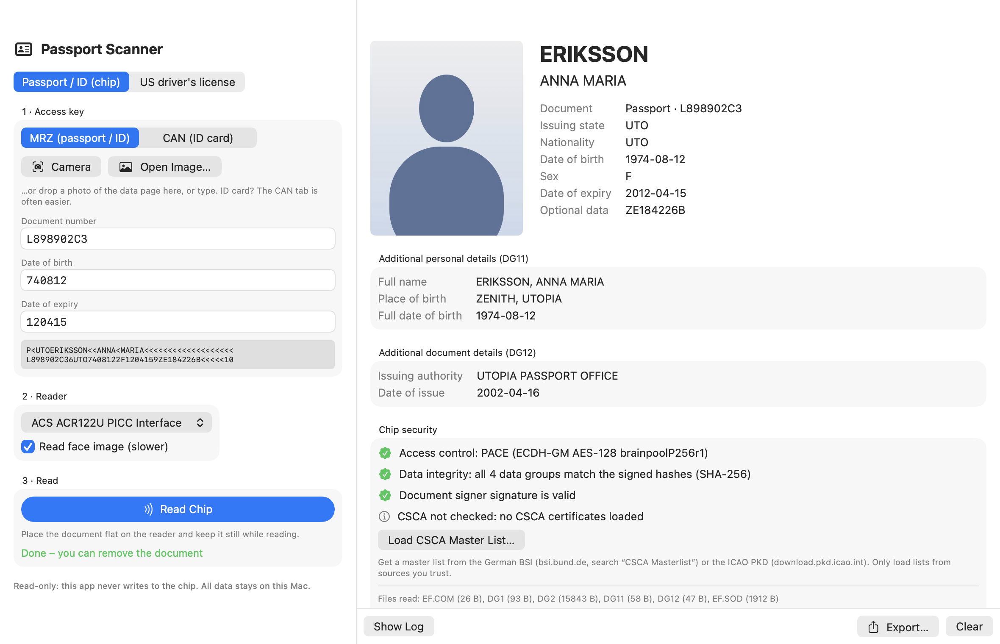

# Passport Scanner (macOS)

Reads the NFC chip of passports and ICAO-compliant ID cards (e.g. EU ID cards) with a USB PC/SC
contactless reader. **Read-only**: the chip layer refuses every command except SELECT, READ BINARY
and the BAC/PACE authentication commands.



*Shown with the fictional ICAO specimen passport (“Anna Maria Eriksson”, Utopia), not real data.
Regenerate with `scripts/screenshot.sh`.*

## Before you trust this app

This app handles highly sensitive personal data: names, dates of birth, document numbers,
addresses and face photos. Don't take its privacy promises on faith, including the ones in this
README. Before you scan a real document, have the source code reviewed independently, for example
by opening the repository in a coding agent such as Claude Code or Codex and asking it to
*follow the instructions in [AGENTS.md](AGENTS.md)*. That file lists what to check: no network
access, no automatic storage, no personal data in logs, and no writing to the chip. Then build the
app yourself from the reviewed source (see below) instead of running a binary someone gave you.

## Build & run

```sh
scripts/build.sh                     # → build/Passport Scanner.app and build/mrtd-read
open "build/Passport Scanner.app"
swift test                           # unit tests (ICAO vectors + simulated chip)
```

The binaries must be signed with `com.apple.security.smartcard` (done by the build script);
without it `TKSmartCardSlotManager.default` is nil and no reader is visible.

Only one reader program runs at a time: the app refuses a second instance, and the app and
`mrtd-read` share a lock file, because two programs polling one PC/SC reader disrupt each other.

## Using it

1. **Access key**: the chip only opens with data printed on the document (so it can't be read from a
   closed passport in someone's pocket):
   - **MRZ**: document number, date of birth, date of expiry. Use *Camera* (live OCR with Vision),
     *Open Image…* / drag & drop a photo, or type them.
   - **CAN**: the 6-digit Card Access Number printed on the front of most EU ID cards (and some
     newer passports). It unlocks the chip like the MRZ and is quicker than scanning a 3-line ID-card MRZ.
     For the camera, only the first two MRZ lines of an ID card are needed.
2. Choose the reader, put the document on it, press **Read Chip**.

Command line equivalent:

```sh
build/mrtd-read --list
build/mrtd-read --probe                         # ATR + supported PACE variants, no key needed
build/mrtd-read --mrz L898902C3,740812,120415 --out ~/Desktop/doc
build/mrtd-read --can 123456 --verbose
build/mrtd-read --ocr photo.jpg                 # MRZ or driver's license barcode from a photo
build/mrtd-read --mrz ... --csca DE_ML.ml       # include the CSCA check
```

## What is supported

| | |
|---|---|
| Access control | BAC (3DES); PACE ECDH Generic Mapping (also used for CAM chips) with 3DES / AES-128/192/256 on NIST P-192…P-521 and brainpool P192r1…P512r1, password = MRZ or CAN |
| Data | DG1 (MRZ), DG2 (face, JPEG / JPEG 2000), DG7 (signature), DG11, DG12; other DGs are read raw |
| Passive authentication | DG hashes vs EF.SOD, messageDigest, Document Signer signature (RSA PKCS#1/PSS with any salt length, ECDSA incl. brainpool & explicit params) |
| CSCA check | Document Signer certificate verified against a loaded CSCA master list (BSI `.ml`, ICAO PKD `.ldif`, PEM/DER certificates); stored in `~/Library/Application Support/PassportScanner/` |
| US / Canadian driver's licenses | PDF417 barcode on the back (AAMVA standard, all versions), via camera or photo; no chip, and the barcode is not signed, so the data is not verified |
| Not supported | DH-based PACE, Integrated Mapping, Extended Access Control (DG3/DG4 fingerprints & iris), Active / Chip Authentication (clone detection) |

## CSCA master list

Passive authentication proves the chip data was signed by a Document Signer; the CSCA check proves that
signer belongs to the issuing country. Download a master list once and load it with
*Load CSCA Master List…* (in the result's security section) or `mrtd-read --csca FILE`:

- German BSI: bsi.bund.de → search “CSCA Masterlist” (`GermanMasterList.zip`, unzip → `.ml`)
- ICAO PKD: download.pkd.icao.int (master lists LDIF)

The master list's own signature is not verified, so only load lists from sources you trust.
`MASTERLIST=/path/file.ml swift test --filter RealMasterList` checks every certificate in a list
(with the BSI list of 2026-10: 597 of 609 verify; the rest were signed by keys no longer in the list).

## Layout

- `Sources/MRTDKit`: protocol library (MRZ, crypto, EC arithmetic, secure messaging, BAC, PACE,
  LDS parsing, SOD verification, CryptoTokenKit transport, Vision MRZ OCR).
- `Sources/PassportScanner`: SwiftUI app.
- `Sources/mrtd-read`: CLI for testing readers and chips.
- `scripts/make_icon.swift`: draws `Resources/AppIcon.icns`.
- `scripts/screenshot.sh`: renders `docs/screenshot.png` (demo mode with the specimen document; see `DemoMode.swift`).
- `Tests/MRTDKitTests`: ICAO 9303 worked examples, OpenSSL cross-checks and a simulated chip
  (`MockChip`) for end-to-end BAC/PACE reads.

## Readers

Tested with an ACS ACR122U. Readers with better RF fields (ACR1252U, Identiv uTrust 3700F,
HID Omnikey 5022) are more reliable with passports, whose antennas are in the cover or data page.
If reads break off midway, keep the document flat and still and try moving it on the reader.

US passports have an RF-shielding layer in the cover: open the passport and lay the back cover
(older passports) or the plastic photo page (newer passports) flat on the reader; a closed US
passport cannot be read.

## License

MIT, see [LICENSE](LICENSE).
